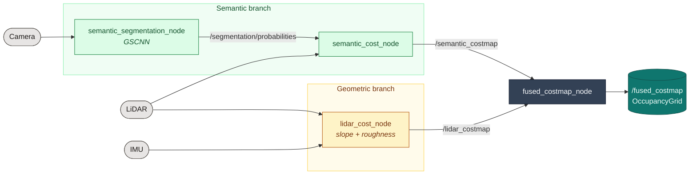

# Multi-Modal Traversability Mapping for Autonomous Off-Road Vehicles

A ROS 2 system that fuses camera-based semantic segmentation with LiDAR geometry into a traversability costmap for off-road navigation. Bachelor thesis, Technical University of Denmark (DTU).

## How it works



- **Semantic:** a fine-tuned GSCNN (ResNet-50) labels each pixel with one of 19 terrain classes. LiDAR points projected into the image pick up the cost of their class and are rasterised into a 2D costmap.
- **Geometric:** slope and roughness are computed from LiDAR neighbourhoods (KD-tree) in a gravity-aligned frame from the IMU.
- **Fusion:** the two costmaps are blended with independent weights. Either one can be turned off.

## Repository layout

```
ros2_ws/src/
├── perception_pkg/       # GSCNN inference, image preprocessing
├── traversability_pkg/   # Semantic, LiDAR and fused costmap nodes
├── bringup_pkg/          # Launch files, sensor configs, RViz config
└── platform_description/ # Warthog URDF
```

## Setup

Requires Ubuntu 22.04 with ROS 2 Humble, Python 3.10+, PyTorch 2.x with CUDA, and [GSCNN](https://github.com/nv-tlabs/GSCNN). The Livox Mid-360 also needs [Livox-SDK2](https://github.com/Livox-SDK/Livox-SDK2) and [livox_ros_driver2](https://github.com/Livox-SDK/livox_ros_driver2).

```bash
pip install torch torchvision numpy opencv-python scipy

cd ros2_ws
colcon build --packages-select perception_pkg traversability_pkg bringup_pkg platform_description
source install/setup.bash
```

Clone GSCNN and put your fine-tuned `.pth` checkpoint somewhere accessible. Pass their paths as `gscnn_root` and `checkpoint_path` when launching (default checkpoint dir: `/root/finetuned_models/`).

## Usage

```bash
# 1. Record raw sensor data (camera, LiDAR, IMU) to /root/data/bags/
ros2 launch bringup_pkg rosbag_record_lidar_image.launch.py

# 2. Segment the bag offline (faster than real-time GPU inference during playback)
ros2 launch bringup_pkg semseg_record_bag.launch.py \
    bag_path:=/root/data/bags/my_raw_bag \
    bag_output:=/root/data/bags/segmented/my_segmented_bag

# 3. Run the fused costmap pipeline (opens RViz)
ros2 launch bringup_pkg fused_costmap_pipeline.launch.py \
    bag_path:=/root/data/bags/segmented/my_segmented_bag

# Or run live on hardware
ros2 launch bringup_pkg fused_costmap_pipeline.launch.py play_bag:=false
```

Main launch arguments:

| Argument             | Default                     | Description                        |
| -------------------- | --------------------------- | ---------------------------------- |
| `bag_path`         | —                          | Pre-segmented bag directory        |
| `play_bag`         | `true`                    | `false` for live hardware        |
| `sensor_config`    | `livox_mid360`            | `livox_mid360` or `ouster_os1` |
| `appearance_alpha` | `0.5`                     | Weight of the semantic costmap     |
| `geometric_alpha`  | `0.5`                     | Weight of the LiDAR costmap        |
| `cost_mode`        | `penalized_expected_cost` | See below                          |

Other launch files in `bringup_pkg/launch/` run the semantic or LiDAR branch on its own.

## Costs

**Cost modes** (`cost_mode`):

| Mode                        | Behaviour                                                                        |
| --------------------------- | -------------------------------------------------------------------------------- |
| `argmax_cost`             | Cost of the most probable class.                                                 |
| `expected_cost`           | Probability-weighted average over the top-K classes.                             |
| `penalized_expected_cost` | `expected_cost` plus a penalty for high entropy, so uncertain areas cost more. |

**Class costs** (0 = free, 1 = lethal), set in `DEFAULT_SEMANTIC_COSTS` in `traversability_pkg/semantic_fusion_utils.py`:

| Cost | Classes                                                           |
| ---- | ----------------------------------------------------------------- |
| 0.05 | asphalt, concrete                                                 |
| 0.10 | dirt                                                              |
| 0.25 | grass                                                             |
| 0.40 | puddle                                                            |
| 0.50 | mud                                                               |
| 0.60 | log                                                               |
| 0.80 | object, bush, rubble                                              |
| 1.00 | water, tree, pole, fence, barrier, building, vehicle, person, sky |

**LiDAR cost:** a weighted sum of slope (`w1 = 0.2`) and roughness (`w2 = 0.8`) over a `0.6` m neighbourhood. Slope reaches cost 1 at 20° and roughness at 2.0. The Livox config merges 3 scans because its scan pattern is sparse. The Ouster config voxel-downsamples at 0.5 m. Parameters are in `bringup_pkg/config/sensors/<sensor>.yaml`.

## Topics

| Topic                            | Type                                  |                           |
| -------------------------------- | ------------------------------------- | ------------------------- |
| `/image_raw`, `/camera_info` | `sensor_msgs/Image`, `CameraInfo` | input                     |
| `/livox/lidar`                 | `sensor_msgs/PointCloud2`           | input                     |
| `/livox/imu`                   | `sensor_msgs/Imu`                   | input                     |
| `/segmentation/probabilities`  | `sensor_msgs/Image`                 | top-k class probabilities |
| `/semantic_costmap`            | `nav_msgs/OccupancyGrid`            | appearance cost           |
| `/lidar_costmap`               | `nav_msgs/OccupancyGrid`            | geometric cost            |
| `/fused_costmap`               | `nav_msgs/OccupancyGrid`            | fused output              |

## Acknowledgements

- [Gated-SCNN](https://arxiv.org/abs/1907.05740), Takikawa et al.
- [RELLIS-3D](https://arxiv.org/abs/2011.12954), Jiang et al.
- [Livox-SDK2](https://github.com/Livox-SDK/Livox-SDK2) and [livox_ros_driver2](https://github.com/Livox-SDK/livox_ros_driver2)
